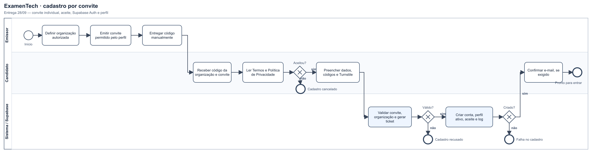
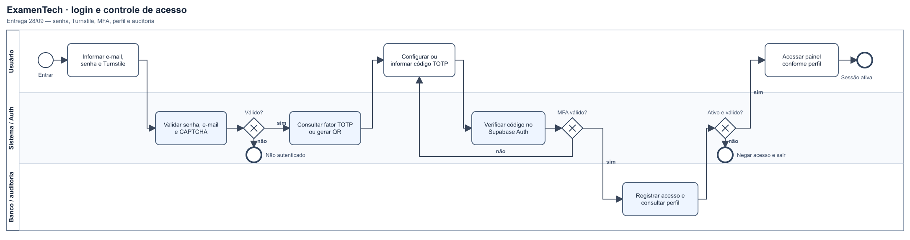

# ExamenTech-PFC2026

Projeto Final de Curso — UMC, 2026 — Grupo 29.

Sistema de Gerenciamento Seguro de Provas e Atividades Acadêmicas (SGPA). Esta versão é uma demonstração acadêmica, com cadastro por convite, autenticação em duas etapas, turmas, matrículas e realização de provas de teste com acompanhamento por câmera.

## Funcionalidades desta etapa

- Login, recuperação de senha, confirmação de e-mail e MFA TOTP com Supabase Auth.
- Cadastro por convite, perfis Aluno/Professor/Administrador e autorização no banco.
- Turmas, solicitação e aprovação de matrículas, rascunhos de avaliações, questões, alternativas e publicação.
- **Minhas provas**: lista em cartões, simulação local e preparação da tentativa com câmera e avisos.
- Questões e alternativas em ordem sorteada persistida, salvamento de respostas e encerramento por envio, prazo, saída da página/aba/janela ou perda persistente da câmera.
- Quando habilitadas, uma foto inicial e até três durante a tentativa, em horários sorteados no servidor. A confirmação da foto inicial precede a liberação das questões.
- Fotos em armazenamento privado, para consulta manual pelo professor responsável ou ADM da mesma organização, com MFA e registro de consulta.
- Reativação excepcional de tentativa interrompida, autorizada pelo responsável com motivo e minutos, preservando respostas e histórico. Prova finalizada não é reaberta.
- Política de Privacidade, Termos, aceite geral e consentimento específico das fotos. Conservação de até 90 dias por foto e rotina de exclusão pelo Storage.
- Auditoria dos fluxos implementados. As tentativas de acesso recusadas antes do MFA também têm os registros próprios do Supabase Auth.

Não há reconhecimento facial automático, gravação contínua de vídeo/áudio ou classificação automática de fraude. Correção e cálculo de notas não fazem parte desta integração. Os componentes de dashboard com dados de exemplo permanecem separados da navegação atual.

## Executar localmente

Requer Node.js **22.18 ou superior**; os scripts da API e dos testes executam TypeScript diretamente. Utilize uma versão compatível com o Vite instalado.

Na pasta que contém `package.json`:

```powershell
npm.cmd ci
```

Se ainda não houver `.env.local`, crie a partir do modelo e preencha a configuração do seu ambiente:

```powershell
Copy-Item .env.example .env.local
npm.cmd run dev:full
```

A interface e a API precisam rodar juntas para as provas e fotografias. Abra o endereço mostrado pelo Vite, normalmente `http://localhost:5173`. Os comandos `npm run dev:web` e `npm run dev:api` iniciam os serviços separadamente. No Windows, `npm.cmd` evita depender da execução de `npm.ps1` pelo PowerShell.

## Configuração por ambiente

O modelo completo está em [.env.example](.env.example). O arquivo local, as chaves privadas, o token da limpeza e o SQL preenchido com esse token ficam fora do Git.

| Variável | Uso |
| --- | --- |
| `VITE_SUPABASE_URL`, `VITE_SUPABASE_PUBLISHABLE_KEY` | Projeto e chave pública no navegador. |
| `VITE_TURNSTILE_SITE_KEY` | Chave pública do Turnstile. |
| `VITE_INVITES_ENABLED` | Cadastro por convite, após configurar as migrações correspondentes. |
| `VITE_MONITORED_EXAMS_ENABLED` | Habilita a execução de avaliações com o banco atualizado até 043. |
| `VITE_EXAM_MANAGEMENT_ENABLED` | Gestão de tentativas e versões novas dos documentos; requer 030–032. |
| `VITE_EXAM_PHOTOS_ENABLED`, `EXAM_PHOTOS_ENABLED` | Necessárias para iniciar Provas. Habilite as duas após preparar banco, bucket e limpeza. |
| `SUPABASE_URL`, `SUPABASE_PUBLISHABLE_KEY` | Configuração opcional explícita da API; se ausentes, usa as equivalentes `VITE_`. |
| `SUPABASE_SECRET_KEY` ou `SUPABASE_SERVICE_ROLE_KEY` | Credencial privada do servidor para arquivos já autorizados e limpeza. Nunca recebe prefixo `VITE_`. |
| `TURNSTILE_SECRET_KEY`, `TURNSTILE_EXPECTED_HOSTNAMES` | Integração separada da API Turnstile. |
| `EXAM_PHOTO_CLEANUP_TOKEN` | Token exclusivo cadastrado no ambiente da função de limpeza no Supabase e no Vault. |
| `CRON_SECRET` | Apenas para a alternativa de limpeza hospedada na Vercel. |

As opções de fotos e gerenciamento vêm desligadas no modelo para não chamar objetos ausentes em outro banco. Depois de aplicar a **032**, habilite `VITE_EXAM_MANAGEMENT_ENABLED=true` para apresentar as versões exigidas nos novos cadastros. Desligar somente as fotos mantém esses documentos novos por meio da opção de gerenciamento.

O `VITE_` é incorporado no build: reinicie os serviços locais ou publique novo build após mudar as opções. Chaves e configurações de um projeto de testes não são copiadas automaticamente para outro ambiente.

## Banco, fotos e limpeza

Arquivos SQL no repositório não são executados pelo Git nem pelo Vite. Em bancos existentes, confira a estrutura antes de aplicar cada arquivo; versões antigas de 023/024 tiveram outro contrato. Não reaplique as migrações ou a ponte do protótipo em uma base já conciliada.

| Etapa | Arquivos |
| --- | --- |
| Acesso, convites, auditoria e aceite | `database/001` a `010`, conforme pré-requisitos documentados. |
| Turmas e matrículas | `database/011` a `018`. |
| Avaliações, questões, publicação e tentativa | `database/019` a `027`. |
| Respostas, encerramento e versões anteriores dos documentos | `database/028` e `029`. |
| Histórico de antigas autorizações | `database/030_reativacao_autorizada.sql`. A 038 revoga a reativação. |
| Fotografias privadas, consentimento e retenção | `database/031_fotos_tentativa.sql`. |
| Versões anteriores dos documentos com fotos | `database/032_documentos_fotos.sql`. |
| Execução segura e ocorrências de prova | `database/043_execucao_segura_prova.sql`, após a 042. |

O bucket usado é **`examentech-evidencias`**, privado, somente `image/jpeg`, até 1 MiB. O banco mantém a coleta desligada ao aplicar 031. A ativação depende de conferir o bucket, a função de limpeza, o agendamento e os avisos.

Roteiros:

- [Fluxo de provas e validação](docs/tentativas-prova.md).
- [Fluxograma da prova com sessão, câmera e fotos](docs/fluxo-prova-monitorada.md).
- [Migração 038 e homologação da tentativa única](docs/tentativas-prova.md#homologação-da-migração-038).
- [Migração 042 e homologação do cancelamento em tempo real](docs/tentativas-prova.md#cancelamento-da-avaliação-rf28rf29).
- [Migração 043 e homologação da execução segura](docs/tentativas-prova.md#execução-segura-e-antifraude-rf30rf36).
- [Ativar fotografias e a consulta pelo responsável](docs/ativar-fotos-e-reativacao.md).
- [Limpeza automática no Supabase para uso em localhost](docs/limpeza-fotos-supabase.md).
- [Termos, Política e versões dos aceites](docs/termos-privacidade.md).
- [Preparação da branch entrega0911](docs/entrega-0911.md).

O agendamento no Supabase funciona sem o computador ligado, enquanto os serviços do projeto estiverem disponíveis. Um HTTP 200 sem arquivos vencidos confirma a chamada; a exclusão física precisa de conferência própria com arquivo fictício vencido. A limpeza tenta remover com antecedência para respeitar o limite de 90 dias e não estende o prazo em reenvios. Falhas exigem acompanhamento e repetição pela equipe.

## Validação observada

Em 08/11/2026, o usuário confirmou a aplicação de 030–032 na base de testes, criação do bucket privado, agendamento ativo e resposta HTTP 200 da limpeza. Também confirmou que fez a prova e consultou as imagens com a conta do professor.

Reativação manual, leitura como ADM, recusa por outra organização e remoção de um arquivo vencido têm cobertura automatizada local; a validação manual completa desses cenários continua no roteiro. Isso não comprova a configuração do Supabase principal.

## Verificar o código

```powershell
npm.cmd run lint
npm.cmd test
npm.cmd run build
```

Os testes usam PostgreSQL local via PGlite e serviços simulados, sem alterar o Supabase. As suítes de banco rodam uma por vez para limitar o consumo de memória. Para executar apenas os testes de tela: `npm.cmd run test:ui`.

Simulações isoladas para desenvolvimento:

- `/dev/pre-prova.html`: prévia de câmera e questão de treino.
- `/dev/fotos-prova.html`: uma foto inicial e três capturas em 30 segundos, somente na memória da página, sem envio.

O fluxo antigo foi separado em `src/dev/legacy`. A aplicação usa `MinhasAvaliacoesPanel` e `TentativaMonitoradaPanel`; a aba separada de pré-prova não faz parte da navegação do aluno.

## Outras integrações

O CAPTCHA de login/cadastro é enviado ao Supabase Auth em `captchaToken`; configure Cloudflare Turnstile no painel de Auth. A rota `/api/validar-turnstile` é uma integração separada, com validação no servidor e eventos técnicos. Um token não deve ser usado duas vezes. Veja [integração Turnstile](docs/integracao-turnstile.md) e [auditoria de acesso](docs/auditoria-cadastro-login.md).

## Modelagem BPMN e branches

`main` guarda a documentação principal; `desenv` reúne o desenvolvimento. As branches `entrega1409` e `entrega2809` representam entregas anteriores. A integração de novembro será revisada na branch `entrega0911`. O [fluxograma atual](docs/fluxo-prova-monitorada.md) descreve sessão, câmera e fotografias dessa etapa.

Os diagramas abaixo descrevem a entrega de **28/09**, não incluem fotografias e reativação de novembro:



[Arquivo BPMN de cadastro](examentech-entrega2809-cadastro.bpmn)



[Arquivo BPMN de acesso](examentech-entrega2809-acesso.bpmn)

Os arquivos PNG permitem visualização no GitHub; BPMN é o formato editável. A documentação acadêmica e os diagramas devem acompanhar o escopo implementado na próxima revisão da equipe.
