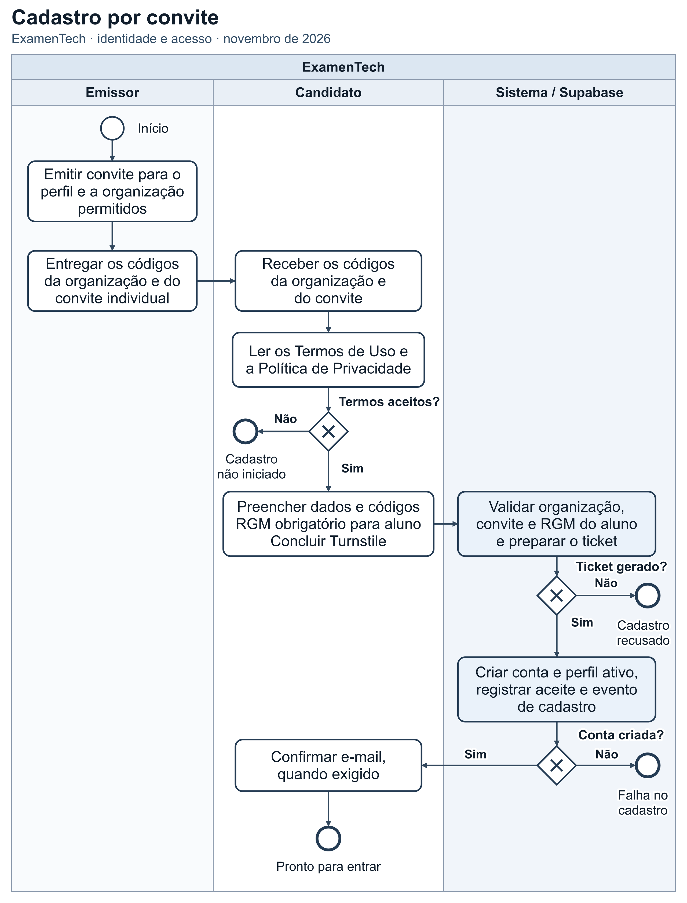
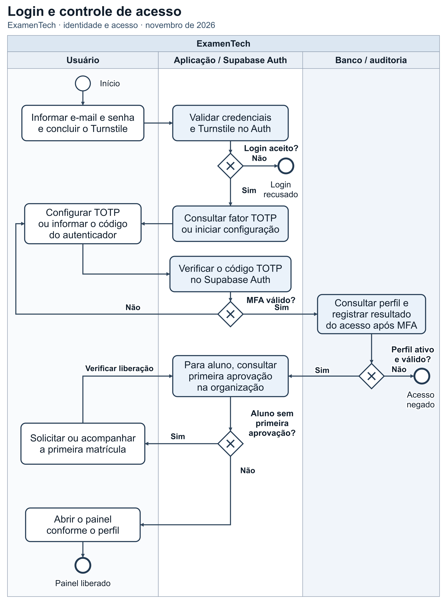
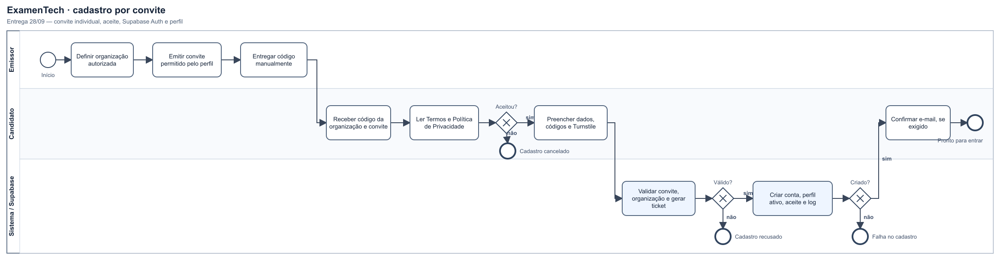
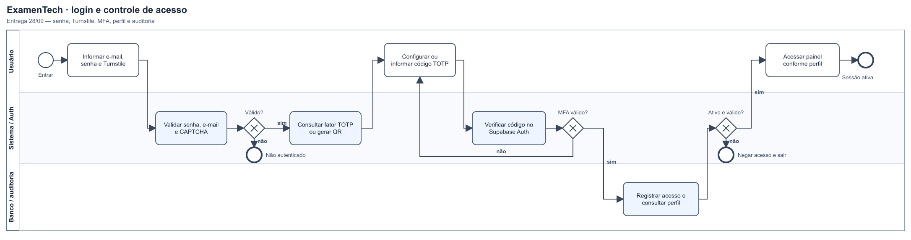

# ExamenTech-PFC2026

Projeto Final de Curso — UMC, 2026 — Grupo 29.

Sistema de Gerenciamento Seguro de Provas e Atividades Acadêmicas (SGPA). Esta versão é uma demonstração acadêmica, com cadastro por convite, autenticação em duas etapas, turmas, matrículas e realização de provas de teste com acompanhamento por câmera.

## Funcionalidades desta etapa

- Login, recuperação de senha, confirmação de e-mail e MFA TOTP com Supabase Auth.
- Cadastro por convite, perfis Aluno/Professor/Administrador e autorização no banco.
- RGM validado para novos alunos; ingresso inicial pelo fluxo de matrícula na primeira turma.
- Redefinição do 2FA de alunos e professores pelo ADM da mesma organização, com auditoria e nova configuração no próximo acesso.
- Turmas, solicitação e aprovação de matrículas, rascunhos de avaliações, questões, alternativas e publicação.
- **Minhas provas**: lista em cartões, simulação local e preparação da tentativa com câmera e avisos.
- Questões e alternativas em ordem sorteada persistida, salvamento de respostas e encerramento por envio, prazo ou saída da página. Em Provas, trocar de aba, perder o foco da janela ou sair da tela cheia pausa a interação e registra uma ocorrência. O aluno pode continuar na mesma aba em tela cheia. Falhas de câmera durante a resolução geram ocorrência e permitem continuar.
- Quando habilitadas, uma foto inicial e até três durante a tentativa, em horários sorteados no servidor. A confirmação da foto inicial precede o início do cronômetro e a liberação das questões.
- Fotos em armazenamento privado, para consulta manual pelo professor responsável ou ADM da mesma organização, com MFA e registro de consulta.
- Tentativa vinculada à sessão e à página que a iniciou, sem reabertura após interrupção.
- Correção, publicação de resultados e dashboard com indicadores do banco por perfil.
- Política de Privacidade, Termos, aceite geral e consentimento específico das fotos. Conservação de até 90 dias por foto e rotina de exclusão pelo Storage.
- Auditoria dos fluxos implementados. As tentativas de acesso recusadas antes do MFA também têm os registros próprios do Supabase Auth.

Não há reconhecimento facial automático, gravação contínua de vídeo/áudio ou classificação automática de fraude.

## 1. Pré-requisitos

- Git e **Node.js 24 LTS**, com npm. O mínimo para os scripts TypeScript é Node 22.18, também compatível com o Vite instalado.
- Projeto Supabase gerenciado, com acesso administrativo a SQL Editor, Auth, Storage e Edge Functions. O desenvolvimento local usa esse projeto remoto; não exige subir PostgreSQL ou Docker na máquina.
- Widget Cloudflare Turnstile e envio de e-mail configurado no Supabase Auth.
- Conta Vercel para publicar o front-end e a API.

Este roteiro prepara a demonstração do PFC com dados fictícios. A versão atual depende das migrações até **061** no mesmo Supabase indicado nas variáveis de ambiente.

## 2. Instalar o projeto

No terminal, clone diretamente a branch de desenvolvimento:

```bash
git clone --branch desenv https://github.com/ModusMartinez/ExamenTech-PFC2026.git
cd ExamenTech-PFC2026
node --version
npm ci
```

Se o repositório já estiver clonado, use sua pasta atual. Para atualizar uma cópia sem alterações pendentes:

```bash
git switch desenv
git pull --ff-only origin desenv
npm ci
```

Crie o arquivo de ambiente **somente se ainda não existir**.

macOS/Linux:

```bash
[ -f .env.local ] || cp .env.example .env.local
```

Windows/PowerShell:

```powershell
if (!(Test-Path .env.local)) { Copy-Item .env.example .env.local }
npm.cmd ci
```

No PowerShell, use `npm.cmd` e `npx.cmd` no lugar de `npm` e `npx` se a política de execução bloquear os scripts `.ps1`.

## 3. Preparar o Supabase

### Banco novo e primeiro administrador

As migrações partem de uma tabela `public.organizacoes` preexistente. **Apenas em um projeto novo**, crie esta base mínima pelo SQL Editor, como `postgres`:

```sql
CREATE TABLE public.organizacoes (
    id UUID PRIMARY KEY DEFAULT gen_random_uuid(),
    nome TEXT NOT NULL,
    token_login TEXT NOT NULL UNIQUE CHECK (token_login ~ '^[A-Za-z0-9_-]{21}$'),
    situacao TEXT NOT NULL DEFAULT 'ATIVO' CHECK (situacao IN ('ATIVO', 'INATIVO'))
);
ALTER TABLE public.organizacoes ENABLE ROW LEVEL SECURITY;
REVOKE ALL ON public.organizacoes FROM anon, authenticated;
```

1. Execute os arquivos `001` a `004` de [database](database), em ordem, pelo SQL Editor.
2. **Antes da 005**, em **Authentication → Users**, crie a conta do primeiro administrador com e-mail confirmado e senha própria. A 005 passa a exigir convite até para usuários criados pelo painel.
3. Copie o UUID dessa conta. Execute os dois comandos abaixo, substituindo os UUIDs pelos valores reais. O primeiro devolve o ID e o código da organização. Guarde o código para os cadastros por convite e use o ID no segundo:

```sql
INSERT INTO public.organizacoes (nome, token_login, situacao, codigo_rotacionado_em)
VALUES ('Instituição de demonstração', left(replace(gen_random_uuid()::TEXT, '-', ''), 21), 'ATIVO', now())
RETURNING id, token_login AS codigo;

UPDATE public.perfis
SET nome = 'Administrador', perfil = 'ADMIN', situacao = 'ATIVO',
    organizacao_id = 'UUID_DA_ORGANIZACAO'::UUID
WHERE id = 'UUID_DO_ADMIN'::UUID
RETURNING id, perfil, situacao, organizacao_id;
```

O `UPDATE` deve devolver exatamente a conta criada. O perfil ADMIN é atribuído por esse procedimento administrativo; o cadastro público usa convites de professor ou aluno.

4. Continue com `005` a `027`, depois **`028_respostas_e_encerramento.sql`** e, por fim, `029` a `061`, sempre em ordem numérica.
5. No primeiro login do administrador pela aplicação, configure e valide o segundo fator TOTP. Depois use o painel para emitir convites; professores confirmam o e-mail e aguardam aprovação administrativa. Alunos confirmam o e-mail e solicitam matrícula em turma.

**Existem duas migrações 028.** A aplicação atual usa `028_respostas_e_encerramento.sql`, que cria `respostas_tentativa`. A alternativa `028_salvar_resposta_tentativa.sql` cria outro contrato e não deve ser aplicada nessa sequência, conforme a própria 033.

### Banco existente

Confira quais arquivos já foram aplicados e execute somente os pendentes. O diretório `database/` não é aplicado automaticamente por `npm`, Git, deploy da Vercel ou `supabase db push`: os arquivos não estão em `supabase/migrations/`.

Bases do protótipo antigo precisam de diagnóstico antes da sequência atual; a [ponte de conciliação](docs/conciliar-banco-provas-teste.sql) tem pré-condições específicas e não faz parte da instalação de um banco novo.

| Migrações | Configuração implementada |
| --- | --- |
| 001–010 | Perfis, convites, organizações, auditoria e aceite. |
| 011–027 | Turmas, matrículas, avaliações, publicação e tentativa única. |
| 028 canônica–038 | Respostas, fotos, consentimento, versões de salvamento e vínculo à sessão/página. A 038 encerra a antiga possibilidade de reativação. |
| 039–043 | Correção, resultados, finalização pelo prazo, cancelamento e execução segura. |
| 044–051 | Dashboards, RGM, recuperação administrativa do MFA, ingresso inicial e linha do tempo. |
| 052–056 | Pausas, indicadores de correção, aprovação de professores, cancelamento ampliado e confirmação de e-mail. |
| 057 | Cronômetro iniciado após a confirmação da foto inicial. |
| 058 | Paginação das tentativas consultadas pelo professor. |
| 059 | Pausas nos totais e no gráfico de ocorrências. |
| 060 | Paginação dos resultados do aluno. |
| 061 | Versões atuais de aceite no cadastro e nos avisos de foto. |

A **041** cria o job `examentech-finalizar-tentativas`, executado a cada minuto. Confira sua presença em `cron.job`; ele finaliza tentativas vencidas mesmo sem a página do aluno aberta. A **042** inclui `public.tentativas` na publicação `supabase_realtime`; mantenha essa configuração para propagar cancelamentos.

### Auth, e-mail e Turnstile

No projeto Supabase utilizado pelo site:

1. Habilite cadastro por e-mail, confirmação de e-mail e MFA TOTP. A aplicação e o banco exigem o segundo fator para acesso acadêmico.
2. Em **Authentication → URL Configuration**, use `http://localhost:5173` como Site URL durante o desenvolvimento e autorize esse endereço em Redirect URLs. A confirmação e a recuperação retornam à raiz do site.
3. Configure um SMTP para enviar confirmação e recuperação aos participantes. Veja [configuração oficial de SMTP](https://supabase.com/docs/guides/auth/auth-smtp).
4. No Cloudflare, configure o widget Turnstile para os hostnames usados, incluindo `localhost` para o desenvolvimento. Copie a site key para o front-end e configure a secret key no CAPTCHA do Supabase Auth. Veja [CAPTCHA no Auth](https://supabase.com/docs/guides/auth/auth-captcha).

O login/cadastro envia `captchaToken` ao Supabase Auth. `/api/validar-turnstile` é uma integração separada; `TURNSTILE_SECRET_KEY` e `TURNSTILE_EXPECTED_HOSTNAMES` configuram essa rota. Um mesmo token Turnstile não deve ser validado duas vezes.

## 4. Preencher `.env.local`

Abra [.env.example](.env.example) como referência e preencha `.env.local` com os dados do projeto escolhido:

| Variáveis | Como configurar |
| --- | --- |
| `VITE_SUPABASE_URL`, `VITE_SUPABASE_PUBLISHABLE_KEY` | URL do Supabase e chave pública/publishable do projeto. |
| `VITE_TURNSTILE_SITE_KEY` | Site key do widget aceito pelo Supabase Auth. |
| `VITE_INVITES_ENABLED=true` | Ative depois de concluir o banco até 061; o cadastro atual exige convite. |
| `VITE_MONITORED_EXAMS_ENABLED=true` | Habilita a execução das avaliações. |
| `VITE_EXAM_MANAGEMENT_ENABLED=true` | Habilita a gestão de tentativas pelo responsável. |
| `SUPABASE_SECRET_KEY` **ou** `SUPABASE_SERVICE_ROLE_KEY` | Preencha uma credencial privada, necessária para fotografias e redefinição administrativa do MFA. Descomente somente a linha escolhida no modelo. |
| `SUPABASE_URL`, `SUPABASE_PUBLISHABLE_KEY` | Opcionais: se ausentes, a API usa as respectivas variáveis `VITE_`. |
| `TURNSTILE_SECRET_KEY`, `TURNSTILE_EXPECTED_HOSTNAMES` | Para a rota própria de Turnstile; hostnames separados por vírgula, sem protocolo nem porta. |
| `VITE_EXAM_PHOTOS_ENABLED`, `EXAM_PHOTOS_ENABLED` | Mantenha `false` até concluir a preparação de fotos abaixo; depois habilite ambas. |
| `EXAM_PHOTO_CLEANUP_TOKEN` | Token exclusivo da limpeza no Supabase, preparado no próximo passo. |
| `CRON_SECRET` | Usado somente pela alternativa de limpeza em `/api/limpar-fotos-expiradas`. O roteiro abaixo agenda a limpeza pelo Supabase. |

Somente as configurações públicas recebem prefixo `VITE_`. Credenciais privadas, tokens e `.env.local` ficam fora do Git. As opções do modelo vêm parcialmente desligadas; os comentários históricos sobre migrações anteriores não substituem a sequência até 061 deste roteiro.

## 5. Preparar fotos e limpeza automática

As Provas exigem coleta de fotos; Atividades usam o fluxo sem fotos. Execute os passos no mesmo Supabase de demonstração configurado no `.env.local`.

### Bucket e preparação local

```bash
node --env-file=.env.local scripts/preparar-bucket-fotos.ts --criar-bucket-privado
node scripts/preparar-fotos-local.mjs --preparar --projeto-teste SEU_PROJECT_REF
```

Substitua `SEU_PROJECT_REF` pela referência de 20 caracteres presente em `https://SEU_PROJECT_REF.supabase.co`. O preparador é destinado à base de testes/demonstração e confere essa URL antes de escrever os arquivos.

O bucket **`examentech-evidencias`** deve ser privado, aceitar apenas `image/jpeg` e limitar cada arquivo a **1 MiB**. O primeiro comando cria o bucket ou confere sua configuração existente.

O segundo gera o token e o SQL de agendamento em `docs/token-limpeza-fotos.local` e `docs/agendar-limpeza-fotos.sql.local`. Também habilita a gestão e mantém as fotos desligadas enquanto a preparação termina. Esses arquivos privados estão ignorados pelo Git.

### Edge Function e agendamento

1. No painel Supabase, crie uma Edge Function chamada **`examentech-limpar-fotos`**, usando o editor. Copie o conteúdo completo de [index.ts](supabase/functions/examentech-limpar-fotos/index.ts) e publique a função.
2. Em **Edge Functions → Secrets**, cadastre `EXAM_PHOTO_CLEANUP_TOKEN` com o valor gerado no arquivo privado. A URL e as credenciais de serviço são obtidas das variáveis fornecidas pelo Supabase. Veja [secrets das Edge Functions](https://supabase.com/docs/guides/functions/secrets).
3. Na configuração da função, ajuste **Verify JWT** para `false`, como em [supabase/config.toml](supabase/config.toml). A função faz sua própria verificação do token exclusivo enviado no cabeçalho `Authorization`; um JWT de usuário não autoriza a limpeza.
4. No SQL Editor, execute **uma vez** o arquivo privado `docs/agendar-limpeza-fotos.sql.local`. Ele prepara Vault, `pg_cron` e `pg_net` e agenda a limpeza diária às 03:00 UTC. Se o agendamento já existir, confira-o em vez de duplicar a configuração. Referência: [agendamento de Edge Functions](https://supabase.com/docs/guides/functions/schedule-functions).
5. Execute [docs/verificar-agendamento-fotos.sql](docs/verificar-agendamento-fotos.sql). Ele consulta o job e dispara uma limpeza; acompanhe o retorno em `net._http_response` ou nos logs da função. Espere HTTP 200. A remoção física deve ser conferida com uma foto fictícia vencida.
6. Depois de confirmar bucket, função e agendamento, habilite a coleta no SQL Editor:

```sql
UPDATE examentech_private.configuracao_fotos SET ativa = TRUE WHERE id = TRUE;
```

Atualize `.env.local`:

```dotenv
VITE_EXAM_MANAGEMENT_ENABLED=true
VITE_EXAM_PHOTOS_ENABLED=true
EXAM_PHOTOS_ENABLED=true
```

Reinicie os serviços após mudar o ambiente. As fotos têm prazo máximo de 90 dias; a limpeza pode removê-las antes do limite para compensar o intervalo entre execuções. O agendamento roda no Supabase, independentemente de o computador ou o front-end estarem ligados.

## 6. Executar localmente

Na pasta com `package.json`:

```bash
npm run dev:full
```

- Front-end: abra o endereço informado pelo Vite, normalmente **http://localhost:5173**.
- API local: **http://127.0.0.1:8787**. O Vite encaminha `/api` para essa porta.
- Mantenha o terminal aberto; `Ctrl+C` encerra os serviços. Se o Vite escolher outra porta, ajuste as URLs autorizadas no Auth.

Para rodar em dois terminais:

```bash
# Terminal 1
npm run dev:web
```

```bash
# Terminal 2
npm run dev:api
```

Use o navegador com câmera disponível e permita seu uso. A Prova pede tela cheia e confirma a foto inicial antes de iniciar o cronômetro. Troca de aba/foco ou saída da tela cheia pausa a interação; o aluno continua na mesma tentativa ao voltar. Fechar ou atualizar a página encerra o acesso à tentativa.

Com os serviços ativos, em outro terminal, uma chamada sem sessão deve devolver **401**:

```bash
curl -i http://localhost:5173/api/turmas
```

No PowerShell, use `curl.exe` no lugar de `curl`. Receber HTML nessa rota indica que a API/proxy não está sendo atendida como esperado.

### Verificar o código

```bash
npm run lint
npm test
npm run build
```

Os testes usam PGlite e serviços simulados, sem alterar o Supabase. `npm run test:ui` executa somente as telas. Para visualizar o front-end compilado:

```bash
npm run preview
```

`preview` serve os arquivos de `dist` e não inicia a API nem configura o proxy de desenvolvimento. Para validar os fluxos completos localmente, use `dev:full`.

## 7. Deploy na Vercel

### Configurar o projeto

A hospedagem usa os arquivos estáticos gerados pelo Vite e as funções Node.js de [api](api). O Supabase continua responsável por Auth, banco, Storage, Realtime e limpeza de fotos.

**Plano da Vercel:** existem **15 arquivos de rota em `api/`**. Nesse formato, cada arquivo gera uma função e o plano Hobby permite até 12 funções por deploy. O deploy completo atual exige capacidade para 15 funções; consolidar rotas para caber no Hobby seria uma alteração de código. Confira os [limites oficiais](https://vercel.com/docs/functions/runtimes#functions-created-per-deployment).

1. Na Vercel, escolha **Add New → Project** e importe `ModusMartinez/ExamenTech-PFC2026`.
2. Use as configurações abaixo. Neste repositório Git, `package.json` está na raiz; o caminho local `PROJETO/ExamenTech-PFC2026` não é uma subpasta do repositório remoto.

| Configuração | Valor |
| --- | --- |
| Framework Preset | `Vite` |
| Root Directory | Raiz do repositório (`.`) |
| Node.js Version | `24.x` |
| Install Command | `npm ci` |
| Build Command | `npm run build` |
| Output Directory | `dist` |
| Production Branch | `desenv`, para publicar a versão atual do projeto |

3. Confira que o deploy selecionado usa a branch `desenv`. Se a importação tiver escolhido `main`, ajuste a Production Branch nas configurações do projeto e faça o deploy de `desenv`. Em **Environment Variables**, cadastre as variáveis da seção 4 nos ambientes utilizados (**Preview** e/ou **Production**). Configure as três opções `VITE_INVITES_ENABLED`, `VITE_MONITORED_EXAMS_ENABLED` e `VITE_EXAM_MANAGEMENT_ENABLED` como `true`. Para Provas, ambas as opções de fotos também precisam estar `true`, com a preparação do Supabase concluída.
4. Mantenha as credenciais privadas sem prefixo `VITE_`. `.env.local` não é enviado automaticamente para o ambiente hospedado. O token da limpeza é necessário na Edge Function/Vault; `CRON_SECRET` só se aplica se a alternativa de limpeza da API for usada.
5. Publique com **Deploy** e confirme no log a geração do front-end e das funções de `api/`. O [vercel.json](vercel.json) já encaminha `/termos` e `/privacidade` à aplicação.
6. No Supabase Auth, atualize **Site URL** e **Redirect URLs** para a origem HTTPS publicada, por exemplo `https://seu-projeto.vercel.app`. Adicione esse hostname ao widget Turnstile e, se usar a rota própria, a `TURNSTILE_EXPECTED_HOSTNAMES`. Para previews, autorize somente os endereços de demonstração que serão usados. Veja [URLs de redirecionamento](https://supabase.com/docs/guides/auth/redirect-urls).

As variáveis `VITE_` entram no build. Depois de alterá-las na Vercel, faça um novo deploy. Banco, migrações, bucket e Edge Function são configurados separadamente da publicação do Git/Vercel. Referências: [Vite na Vercel](https://vercel.com/docs/frameworks/frontend/vite), [variáveis de ambiente](https://vercel.com/docs/environment-variables).

### Publicar pelo terminal

Com o projeto e as variáveis já configurados no painel, execute na pasta do repositório:

```bash
npx vercel login
npx vercel link
npx vercel deploy
```

Em `link`, selecione o projeto existente. `deploy` cria um **Preview** para conferência. Para publicar em Production:

```bash
npx vercel deploy --prod
```

Confira o projeto de destino antes de publicar. Os comandos constam na [documentação da CLI](https://vercel.com/docs/cli/deploy).

### Conferir o ambiente publicado

- Abra a página inicial, `/termos` e `/privacidade` diretamente pela URL HTTPS.
- Confira `/api/turmas` sem sessão: deve responder 401, não uma página HTML ou 404 de arquivo estático.
- Com contas de demonstração, valide convite, confirmação de e-mail, MFA, matrícula, foto inicial, realização, correção e publicação do resultado.
- Confira os jobs `examentech-finalizar-tentativas` e `examentech-fotos-retencao` no Supabase. Publicar a Vercel não cria esses jobs.
- Se uma chamada falhar, consulte os logs da Function correspondente na Vercel e os logs do Supabase; um build concluído não valida as integrações remotas.

## Diagnósticos disponíveis

- [Banco e contrato das provas](docs/diagnostico-banco-provas.sql).
- [Identidade, ingresso e MFA](docs/diagnostico-identidade-1211.sql).
- [Fotos e funções de armazenamento](docs/diagnostico-fotos-e-reativacao.sql).
- [Permissões das RPCs de prova](docs/diagnostico-permissoes-rpc-provas.sql).

Os scripts de diagnóstico consultam a estrutura e ajudam a conferir a base existente; não substituem a aplicação administrativa das migrações pendentes.

## Diagramas do PFC — 16/11

Os diagramas de identidade e acesso representam as regras de RGM e primeira matrícula das migrações 045 e 047. Use os PNGs para a monografia e os arquivos `.bpmn` para editar os modelos.

### Cadastro por convite

O convite define perfil e organização. O sistema valida o RGM de novos alunos e vincula o valor ao ticket de cadastro.



[Modelo BPMN do cadastro](docs/diagramas/identidade-acesso/cadastro-por-convite.bpmn)

### Login e controle de acesso

Depois do MFA, o sistema verifica o perfil e consulta o ingresso do aluno. Alunos que ainda não tiveram matrícula aprovada podem solicitar ou acompanhar a matrícula e usar **Verificar liberação** para consultar a aprovação.



[Modelo BPMN do login](docs/diagramas/identidade-acesso/login-e-controle-de-acesso.bpmn)

## Diagramas históricos — 28/09

Os diagramas abaixo descrevem a entrega de **28/09**, não incluem fotografias e reativação de novembro:



[Arquivo BPMN de cadastro de 28/09](https://github.com/ModusMartinez/ExamenTech-PFC2026/blob/26b53174b624ffe74ee46498d77797ba591f2165/examentech-entrega2809-cadastro.bpmn)



[Arquivo BPMN de acesso de 28/09](https://github.com/ModusMartinez/ExamenTech-PFC2026/blob/26b53174b624ffe74ee46498d77797ba591f2165/examentech-entrega2809-acesso.bpmn)

Os arquivos PNG permitem visualização no GitHub; BPMN é o formato editável. A documentação acadêmica e os diagramas devem acompanhar o escopo implementado na próxima revisão da equipe.
