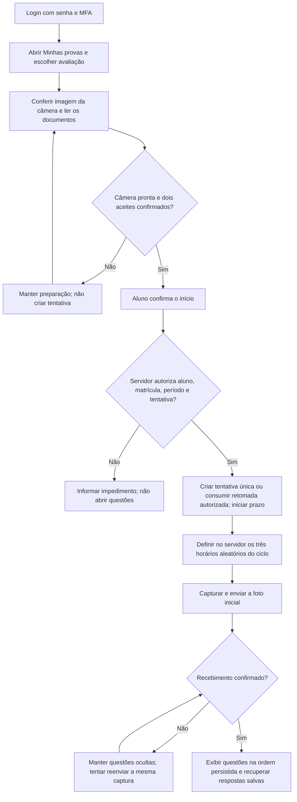
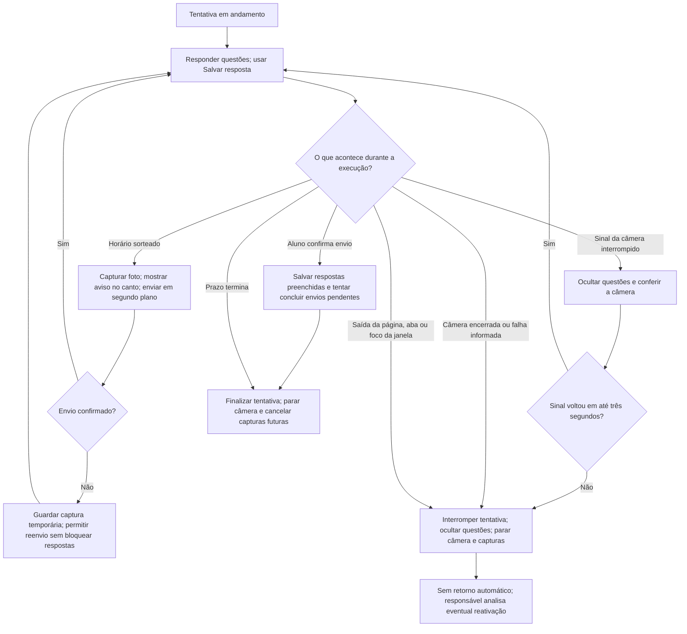
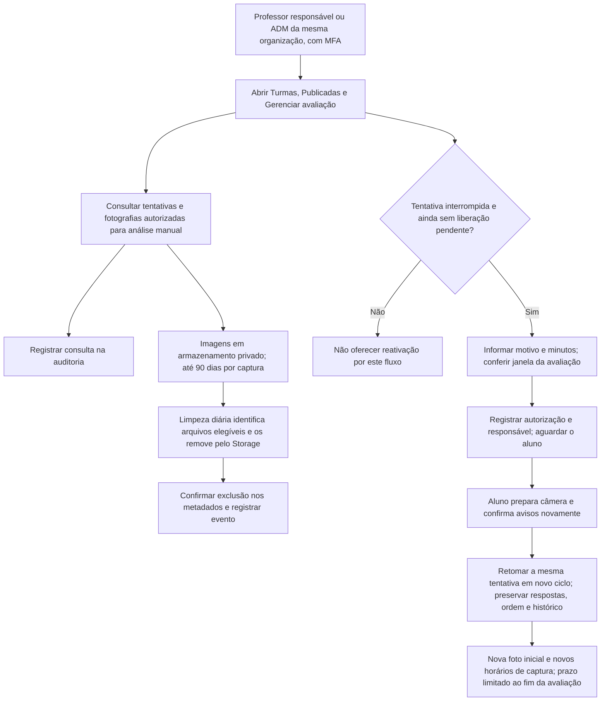

# Fluxo da prova com câmera, fotografias e reativação

Fluxograma da implementação da `entrega0911`, conferido com as telas e as funções de 025–032. Os diagramas descrevem o ambiente com gerenciamento e fotografias habilitados. As simulações locais continuam separadas da tentativa real.

## 1. Preparação e início

A preparação fica dentro de **Minhas provas**. Antes de criar a tentativa, a câmera precisa estar disponível e os avisos precisam estar confirmados. A autorização de aluno, matrícula e período é conferida pelo servidor.

O aceite geral e o consentimento das fotos são separados e começam desmarcados. O prazo começa quando o servidor confirma a tentativa; o preparo da foto inicial ocorre depois desse início. Falha de conexão no envio não é classificada como falha de câmera.

## 2. Durante a tentativa

As capturas posteriores são programadas conforme a duração disponível, sem abrir outra janela nem tirar o foco do aluno. Uma prova enviada antes dos horários restantes não aguarda novas fotos.

As respostas não têm salvamento automático periódico: são gravadas pelo botão **Salvar resposta** e, quando possível, ao confirmar o envio da prova. Ao vencer o prazo ou ocorrer uma interrupção, respostas ainda não salvas podem se perder.

O sistema observa visibilidade da aba, perda de foco e saída da página. Não exige tela cheia nem trata copiar/colar como ocorrência nesta implementação. Uma faixa de câmera encerrada ou a falha informada pelo aluno interrompe sem esperar o prazo de recuperação de um sinal temporário. Não há contagem de três falhas para liberar retornos automáticos.

Fechar o navegador ou perder a rede pode impedir que o encerramento chegue imediatamente ao banco. O prazo continua correndo, e uma nova chamada de início não oferece retorno automático. A detecção de imagem preta depende do dispositivo; existe o botão **Minha imagem ficou preta**.

## 3. Responsável, reativação e retenção

A consulta das fotos pode ocorrer enquanto a tentativa está em andamento ou depois de encerrada, respeitando acesso e validade. A autorização não depende apenas de o botão estar visível: as funções do banco conferem perfil, sessão, MFA e vínculo com a organização/avaliação.

Tentativa finalizada por envio ou prazo não é reaberta por esse procedimento. A retomada autorizada não apaga os eventos anteriores e exige outro consentimento para novas fotos.

O limite de 90 dias é conservador, ancorado no horário programado no servidor; atrasos e reenvios não o estendem. A rotina diária trabalha com antecedência para respeitar o limite. Falhas de exclusão precisam ser acompanhadas e repetidas. O acesso é negado após a validade mesmo se uma remoção física estiver pendente. Revogação do consentimento bloqueia novos envios e consultas dos ciclos envolvidos e os inclui na limpeza.

Não há gravação contínua de áudio ou vídeo, reconhecimento facial nem identificação automática de fraude. As imagens são evidências para análise humana, sem garantia de identidade por si só.

## Referências da implementação

- `src/components/TentativaMonitoradaPanel.tsx`: preparo, aceite, respostas, câmera e permanência.
- `src/hooks/useExamPhotos.ts`: programação, captura e reenvio das fotos.
- `src/components/TentativasResponsavelPanel.tsx`: consulta e liberação pelo responsável.
- `database/030_reativacao_autorizada.sql`: autorização excepcional e preservação das respostas.
- `database/031_fotos_tentativa.sql`: consentimentos, horários, autorização das imagens e retenção.
- `supabase/functions/examentech-limpar-fotos/index.ts`: remoção dos arquivos elegíveis.

Veja também o [roteiro de testes](tentativas-prova.md), a [ativação](ativar-fotos-e-reativacao.md) e a [limpeza automática](limpeza-fotos-supabase.md).
