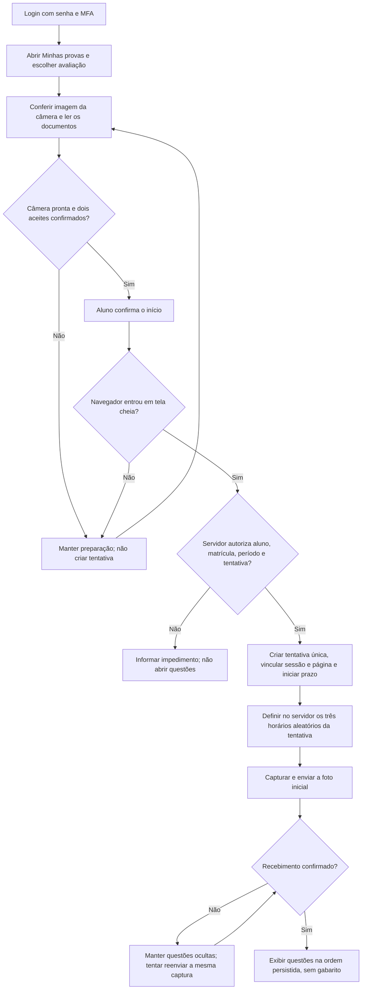
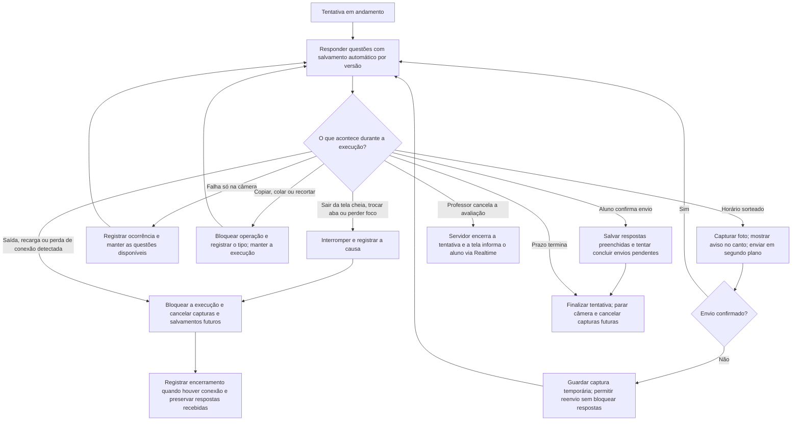
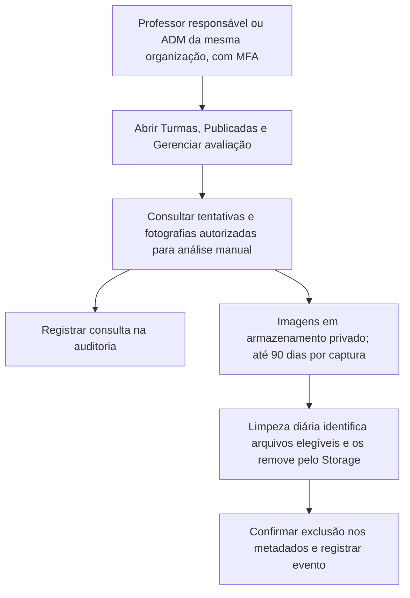

# Fluxo da prova com sessão e fotografias

Fluxograma da implementação da `entrega0911` com as regras da migração 043. O fluxo monitorado se aplica a Provas. Atividades usam a tentativa única sem câmera, tela cheia ou bloqueio da área de transferência. A simulação local continua separada da tentativa real.

## 1. Preparação e início

A preparação fica dentro de **Minhas provas**. Antes de criar a tentativa de uma Prova, a câmera precisa estar disponível, os avisos precisam estar confirmados e o navegador precisa entrar em tela cheia. O servidor confere a autorização do aluno, a matrícula, o período e os avisos.

O aceite geral e o consentimento das fotos são separados e começam desmarcados. O prazo começa quando o servidor confirma a tentativa; o preparo da foto inicial ocorre depois desse início. Falha de conexão no envio não é classificada como falha de câmera.

## 2. Durante a tentativa

As capturas posteriores são programadas conforme a duração disponível, sem abrir outra janela nem tirar o foco do aluno. Uma prova enviada antes dos horários restantes não aguarda novas fotos.

O banco exige a sessão inicial e a chave da página em todas as operações de execução. A página pode confirmar o encerramento após reconectar. Uma nova página não tem a chave inicial. O navegador pode fechar antes de registrar a interrupção no banco.

## 3. Consulta de fotos e retenção

A consulta das fotos pode ocorrer enquanto a tentativa está em andamento ou depois de encerrada, respeitando acesso e validade. A autorização não depende apenas de o botão estar visível: as funções do banco conferem perfil, sessão, MFA e vínculo com a organização/avaliação.

A consulta pelo responsável preserva o histórico da tentativa. A tentativa não pode ser reaberta.

O limite de 90 dias é conservador, ancorado no horário programado no servidor; atrasos e reenvios não o estendem. A rotina diária trabalha com antecedência para respeitar o limite. Falhas de exclusão precisam ser acompanhadas e repetidas. O acesso é negado após a validade mesmo se uma remoção física estiver pendente. Revogação do consentimento bloqueia novos envios e consultas dos ciclos envolvidos e os inclui na limpeza.

Não há gravação contínua de áudio ou vídeo, reconhecimento facial nem identificação automática de fraude. As imagens são evidências para análise humana, sem garantia de identidade por si só.

## Referências da implementação

- `src/components/TentativaMonitoradaPanel.tsx`: preparo, aceite, respostas, câmera e permanência.
- `src/hooks/useExamPhotos.ts`: programação, captura e reenvio das fotos.
- `src/components/TentativasResponsavelPanel.tsx`: consulta pelo responsável.
- `database/038_tentativa_sessao.sql`: vínculo com a sessão inicial e bloqueio de retomada.
- `database/043_execucao_segura_prova.sql` exige a foto inicial e registra ocorrências.
- `database/031_fotos_tentativa.sql`: consentimentos, horários, autorização das imagens e retenção.
- `supabase/functions/examentech-limpar-fotos/index.ts`: remoção dos arquivos elegíveis.

Veja também o [roteiro de testes](tentativas-prova.md), a [ativação](ativar-fotos-e-reativacao.md) e a [limpeza automática](limpeza-fotos-supabase.md).
